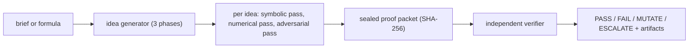

# Deviatrix Genesis

An idea-exploration pipeline: give it a brief or a formula, it generates candidate
ideas, checks every claim it makes with symbolic math and statistics, and ends the run
with a computed pass/fail verdict instead of prose. For teams who want idea work they
can audit with numbers.

[](https://github.com/mrodgersjs-web/deviatrix-genesis/actions/workflows/ci.yml)
[](LICENSE)
[](https://www.python.org/downloads/)

## Why this exists

Idea documents are easy to fake: a confident paragraph with a decorative equation
costs nothing. This pipeline refuses to do that. Every formula it states is parsed and
solved by SymPy, every statistical claim is computed from the run's own data with
robust estimators, and an independent verifier reads the sealed results and decides
whether each claim passes, fails, or needs another pass. The output is a trail of
checkable artifacts, not a mood.

## Quickstart

```bash
git clone https://github.com/mrodgersjs-web/deviatrix-genesis.git
cd deviatrix-genesis
python3 -m venv .venv && . .venv/bin/activate
pip install -e '.[dev]'
python -m deviatrix_genesis run-full --formula "x**2 + 3*x + 1" --pop-size 500 --out ./proofs
```

That one install is the whole setup: `sympy` comes in as a dependency, and the tests
run with a single command afterwards:

```bash
pytest
```

## How it works



The three phases are Opportunity, Invention and Proof. Each generated idea goes
through three passes: a symbolic check (is the math valid at all?), a numerical check
(robust statistics over the run's population), and an adversarial check (does it
survive perturbation?). Everything is sealed and re-read by a verifier that shares no
state with the generator. The seven-stage workflow (IQRSQPI in the module names) is
the checklist each pass walks.

## What it proves

- `pytest` runs the full suite from a clean install with no extra steps.
- `python -m deviatrix_genesis run-full ...` writes sealed proof packets into the
  output directory you name; the verifier's verdict is in each packet.
- Re-running the same command produces the same verdicts (the pipeline is
  deterministic given the same seed).

## Project layout

```
deviatrix_genesis/schemas.py     the contracts every layer speaks
deviatrix_genesis/sympy_mcp/     symbolic math: parse, solve, simplify, checks
deviatrix_genesis/mathexec/      robust statistics and the three-pass executor
deviatrix_genesis/diamonds/      the three phases and their routing table
deviatrix_genesis/iqrsqpi/       the seven-stage workflow
deviatrix_genesis/conductors/    runs the phases and writes artifacts
deviatrix_genesis/cli/           the deviatrix command line
deviatrix_genesis/{v3,v4,v5}/    later pipeline generations, each with tests
```

## Development

```bash
pip install -e '.[dev]'
ruff check deviatrix_genesis
pytest
```

## Contributing, security, license

See [CONTRIBUTING.md](CONTRIBUTING.md), [SECURITY.md](SECURITY.md), and the
[MIT license](LICENSE). Report security issues privately to
security@rodgersintelligence.com.

Built by Mike Rodgers · rodgersintelligence.com
