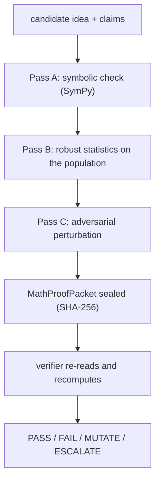

# Architecture

## What the pipeline does

Deviatrix Genesis takes a brief or a formula and produces candidate ideas whose every
claim is checked by a computation before anyone reads it. The design goal is that a
skeptical reader can re-verify the run from the artifacts alone.

## Layers

| Layer | Module | Role |
|-------|--------|------|
| Contracts | `deviatrix_genesis/schemas.py` | The typed objects every other layer passes; nothing else crosses layer boundaries. |
| Symbolic math | `deviatrix_genesis/sympy_mcp/` | Parses, solves, simplifies formulas; runs assumption and singularity checks. Every formula in an artifact went through here. |
| Statistics | `deviatrix_genesis/mathexec/` | Robust estimators (MAD-Z, Qn), bootstrap and conservative minimums computed from the run's own population. |
| Three-pass executor | `deviatrix_genesis/mathexec/executor.py` | Pass A symbolic validity, Pass B numerical robust deviation, Pass C adversarial perturbation. |
| Phases | `deviatrix_genesis/diamonds/` | Opportunity, Invention, Proof; each runs positive, negative and repaired passes over its ideas. |
| Workflow | `deviatrix_genesis/iqrsqpi/` | The seven-stage checklist walked per pass. |
| Conductor | `deviatrix_genesis/conductors/` | Orchestrates the phases and writes artifacts to the output directory. |
| Verifier | `deviatrix_genesis/verifier.py` | Reads sealed packets (SHA-256), re-checks them, and decides PASS / FAIL / MUTATE / ESCALATE. It shares no state with the generator. |
| CLI | `deviatrix_genesis/cli/main.py` | `deviatrix run-full`, `run-diamond`, `run-expedition`, `status`, `sympy-check`. |

Later generations of the pipeline live in `v3/` (corpus, proposer, ensemble,
calibration), `v4/` (async runner, hashed embeddings, formula emitter) and `v5/`
(async DAG executor, telemetry, benchmark harness). Each keeps its own tests.

## Sealing and verification

The packet seal is what makes the run auditable: a packet that was edited after
sealing no longer matches its hash, and the verifier recomputes rather than trusting
stored values.

## Determinism

Given the same inputs and seed, generation, scoring and verdicts are reproducible.
That is what lets tests assert exact outcomes and what makes two runs comparable.
